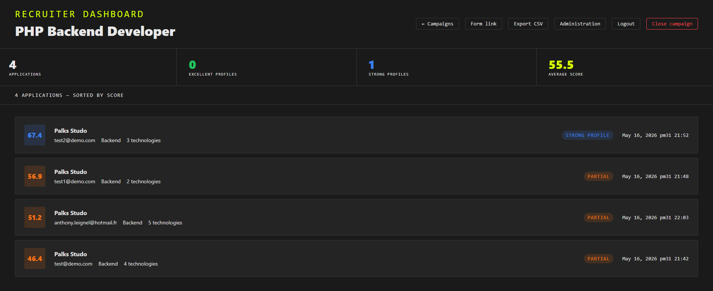

<p align="center">
  
</p>

> 🇬🇧 English | [🇫🇷 Français](./README_FR.md)


[](https://www.youtube.com/@Palks_Studio)
[](https://www.linkedin.com/in/palks-studio/)
[](https://dev.to/palks_studio/i-built-a-full-recruitment-system-in-php-no-database-no-saas-no-subscription-ff1)
[](https://palks-studio.com/en/recruitment-without-saas)

<p align="center">
  <a href="https://palks-studio.com">
    
  </a>
</p>

# Palks Studio — Autonomous recruitment system  
**Structured recruitment with automatic candidate scoring, application management and autonomous server deployment**

> This repository is a technical presentation and documentation repository.  
> It does not contain downloadable source code or production files.

This README documents design principles and system architecture.  
It intentionally avoids operational procedures and sensitive details.

---

## Overview

> Automatic matching recruitment system — PHP 8.x, no database, no SaaS.

CANDIDATE_SYSTEM is an autonomous recruitment engine deployable on any standard Apache / PHP 8.x hosting.

The applicant fills out a structured form. Their answers are automatically scored against a job profile defined by the recruiter. The dashboard displays applications ranked by matching score — from most to least relevant.

No database. No SaaS. No subscription. Data stays on the client's server.

Curious to see the full application? The complete demo playlist is available here: [Watch the Complete Demo Playlist](https://www.youtube.com/watch?v=6MfCHOp23fA&list=PLP79X9pb3KlU)

For a closer look at the technical architecture, this article explores the design of the recruitment system, its scoring engine, and the engineering choices behind a self-hosted solution with no database or SaaS dependency.

👉 [I Built a Full Recruitment System in PHP (No Database, No SaaS, No Subscription)](https://dev.to/palks_studio/i-built-a-full-recruitment-system-in-php-no-database-no-saas-no-subscription-ff1) (DEV.to)

---

## Project Structure

```
candidate_system/
│
├── public/
│  ├── panel.php                      → Administrator interface
│  ├── record.php                     → Detailed application view
│  ├── finalize.php                   → Voluntary permanent campaign closure and data purge
│  ├── success.php                    → Post-submission confirmation page
│  ├── overview.php                   → Recruiter dashboard (restricted access)
│  ├── file.php                       → Secure uploaded file download
│  ├── extract.php                    → CSV generation
│  ├── form.php                       → Application form
│  ├── campaign.php                   → Campaign creation form and new campaign generator
│  └── process.php                    → Processing, validation, scoring, storage
│
└── core/
   ├── settings/
   │   ├── init.php                   → Centralized absolute paths
   │   └── profile.php                → User data
   │
   ├── presets/
   │   ├── fields.json                → Default question template
   │   └── template.php               → Default profile template
   │
   ├── storage/                       → Campaign storage
   │   └── batch_1/
   │        ├── settings/
   │        │   ├── fields.json       → Questions and scoring configuration
   │        │   └── template.php      → Job profile configuration
   │        │
   │        └── records/
   │            ├── entries/          → JSON applications
   │            ├── files/            → Uploaded CVs and documents
   │            ├── archives/         → (reserved)
   │            ├── logs/             → (reserved)
   │            └── closed.lock       → Campaign closure lock
   │
   ├── engine.php                     → Scoring engine
   ├── notify.php                     → Acknowledgement email sender
   ├── LICENSE.md                     → Terms of use and legal framework
   │
   └── docs/
       ├── USER_GUIDE.md              → User guide
       └── README.md                  → Technical documentation
```


---

## Features

- Multi-section application form with conditional fields  
- Automatic multi-criteria scoring (section weights, question weights, scores per answer)  
- Configurable penalties for specific answers  
- Automatic candidate ranking based on matching scores  
- Password-protected recruiter dashboard  
- Unlimited campaign management, with each campaign operating independently  
- Detailed application view with section scores and progress bars  
- Technical stack with highlighted matching skills  
- Excel-compatible CSV export (UTF-8 BOM, `;` separator)  
- Full administration interface with no technical intervention required  
- Automated emails: application acknowledgment and campaign closure  
- Campaign closing and reopening directly from the dashboard  
- Voluntary permanent campaign closure with data purge  
- Unique application form link per campaign, copyable in one click  
- Self-hosted server deployment  
- No AI, no SaaS, no database

[Explore the system](https://palks-studio.com/en/recruitment-without-saas)

---

## Requirements

- PHP 8.x  
- Apache with `mod_rewrite` enabled  
- FTP or SSH access  
- No database  
- No external dependencies (no Composer, no npm)

---

## Scoring Logic

The final score is calculated across three nested levels:

```
contribution = scores[answer] × (weight / 100) × (global_weight / 100)
```


| Level | Parameter       | Description                               |
|-------|-----------------|-------------------------------------------|
| 1     | `global_weight` | Section weight in the final score         |
| 2     | `weight`        | Question weight within its section        |
| 3     | `scores`        | Raw score assigned to each answer         |

**Default distribution:**

| Section          | Global weight |
| ---------------- | ------------: |
| **Education**    |       **20%** |
| **Experience**   |       **60%** |
| **Skills**       |       **15%** |
| **Availability** |        **5%** |

Weights are fully reconfigurable from the administration interface.

**Score levels:**

| Score | Label       |
|-------|-------------|
| ≥ 80  | Excellent   |
| ≥ 60  | Good fit    |
| ≥ 40  | Partial     |
| < 40  | Insufficient|

---

## Security

- Strict public / private separation — no config files accessible via the web  
- CSRF protection on the application form  
- HTTP security headers on all pages  
- Full sanitization of user inputs  
- Upload validation: PDF only, 5 MB maximum  
- Session required for all administration pages  
- Email deduplication per campaign  
- `Options -Indexes` enabled on the public directory  
- Anti-flood protection on public forms  
- Access code validation for configuration exports

---

## Data Storage

Each application is stored as a JSON file:

```json
{
  "id": "20260514_143000_abc123",
  "date": "2026-05-14 14:30:00",
  "job_title": "Job title",
  "first_name": "First name",
  "last_name": "Last name",
  "email": "email@applicant.com",
  "final_score": 74.5,
  "score_label": "Good fit",
  "score_detail": {},
  "answers": {},
  "trigger_fields": {}
}
```


---

© Palks Studio — see LICENSE.md  
- https://palks-studio.com
